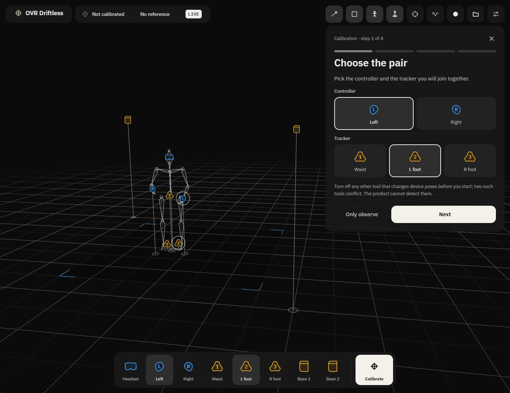
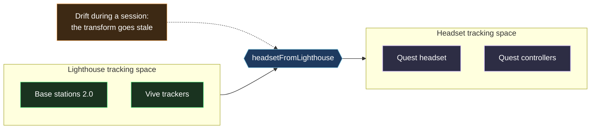
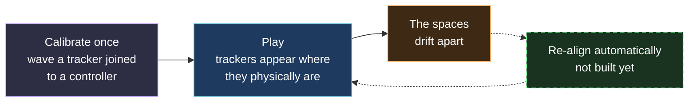
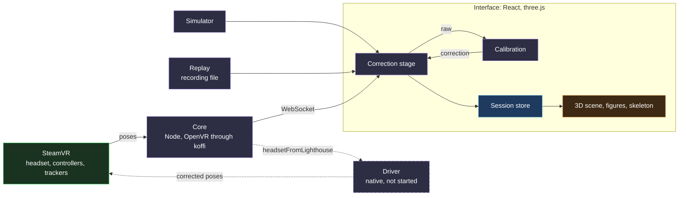

<div align="center">

# OVR Driftless

**Calibration, recording and drift-free alignment for Lighthouse trackers used
with a Quest or another inside-out headset in SteamVR.**

<table>
  <tr>
    <th width="33%">Calibration</th>
    <th width="33%">Recording</th>
    <th width="33%">Driftless</th>
  </tr>
  <tr>
    <td valign="top">Aligns the Lighthouse tracking space with the headset's: join a tracker to a controller, wave the pair, done.</td>
    <td valign="top">Records what both tracking systems report to a file and replays it in the same 3D scene, to see when and how far they drifted apart.</td>
    <td valign="top">Keeps the two spaces aligned for the whole session: no recalibration by hand, no tracker on the headset, no root.</td>
  </tr>
  <tr>
    <td><sub>Runs in the interface; not applied to SteamVR yet</sub></td>
    <td><sub>Works on live SteamVR data and on the simulator</sub></td>
    <td><sub>Planned; the reason the project exists</sub></td>
  </tr>
</table>

[](https://github.com/dev-okinawa/OVR-Driftless/actions/workflows/ci.yml)




</div>

> [!WARNING]
> Early development. Nothing aligns tracking spaces during a session yet, and
> nothing changes poses in SteamVR. Until the driver exists, calibrate in SteamVR
> with [OpenVR Space Calibrator](https://github.com/hyblocker/OpenVR-SpaceCalibrator).

## The Problem

When a Quest or another inside-out headset is combined with Lighthouse devices
such as Vive trackers, the two tracking systems have separate coordinate spaces.
One transform, `headsetFromLighthouse`, places the Lighthouse devices in the
headset's space.



A tool such as OpenVR Space Calibrator finds this transform once. It does not
hold: some time into the session the trackers appear in VR away from where they
physically are, and the calibration has to be repeated by hand.

## The Goal

Both jobs in one tool: the initial calibration, made by waving a tracker joined
to a controller, and keeping the two spaces aligned for the rest of the session,
without a tracker mounted on the headset and without rooting it.



Two tools that change device poses in SteamVR conflict, so OVR Driftless is
meant to replace the calibration tool, not to run beside it.

## Status

| Part | State |
|---|---|
| 3D scene: devices of both tracking systems, recording and replay, desynchronization figures, body skeleton | Works on live SteamVR data, simulated data and recordings |
| Connection to SteamVR | The core reads devices, tracker roles and poses and serves them to the interface; run on a Quest 3 through Virtual Desktop with a VIVE Tracker 3.0 and base stations |
| Initial calibration | Built in the interface and runs on the simulator; the correction applies only to what the interface shows, measures and records, not to SteamVR |
| Automatic alignment | Not started; the method depends on measurements the scene will make |

First supported configuration: Quest 3 / 3S streamed with Virtual Desktop into
SteamVR, SteamVR 2.0 base stations, Quest controllers, Vive trackers.

## How It Works

A background Node process, the core, reads device poses from SteamVR and serves
them to a web interface over a local WebSocket. The interface shows both tracking
systems in one 3D scene, computes the initial calibration and applies the
correction to what it shows, measures and records. Applying it to SteamVR needs a
native driver, which is not started. Dashed lines are the planned part.



The simulator, a replay of a recording and the live connection feed the same
pipeline, so the whole interface runs without VR hardware. More in
[Architecture](docs/architecture/architecture.md).

## Getting Started

Requires Node 24 and npm 11. All code is under `source/`.

```sh
cd source
npm install
npm run dev        # the core and the interface at http://localhost:5173
```

The interface starts on SteamVR: the core, started with it, finds the devices and
streams their poses; until SteamVR runs the scene says so and connects on its own
when it starts. Tracker body parts come from the roles set in SteamVR's "Manage
Trackers".

Without VR hardware, choose Simulator under Source in Settings: a person with a
headset, two controllers and three trackers in a room with two base stations. Its
Simulator tab injects the faults the product deals with — drift of the Lighthouse
space, jumps of the headset origin, tracking loss.

Other commands, run from `source/`:

| Command | Purpose |
|---|---|
| `npm test` | Unit tests of the interface and the core |
| `npm run typecheck` | Type check of the interface and the core |
| `npm run build` | Production build of the interface |
| `npm run dev:fake` | The interface on a fake SteamVR served by the real core, without VR hardware |
| `npm run core` | The core alone, on `ws://127.0.0.1:47115` |
| `npm run core:fake` | The core alone, on a fake SteamVR |
| `npm run probe` | Print device poses from a running SteamVR |

## Repository Layout

| Path | Contents |
|---|---|
| `source/web/` | The interface: Vite, TypeScript, React, three.js |
| `source/core/` | The background process that talks to SteamVR |
| `docs/` | Design, specification, architecture and research |

## Documentation

Start at [docs/README.md](docs/README.md).

- [Product design](docs/design/design.md) — the problem, the goal and open questions
- [Architecture](docs/architecture/architecture.md) — components and data flow
- [Research](docs/research/space-alignment.md) — why tracking spaces drift apart,
  existing tools, candidate methods

## Related Projects

- [OpenVR Space Calibrator](https://github.com/hyblocker/OpenVR-SpaceCalibrator) —
  one-time calibration, and continuous calibration with a tracker on the headset
- [OpenVR-SpaceSync](https://github.com/shinyflvre/OpenVR-SpaceSync) — alignment
  without a tracker on the headset, using a waist tracker
- [QuestLHSync](https://github.com/CreoleVR/QuestLHSync) — alignment through the
  headset cameras; needs root

## Contributing

Bug reports, measurements from real hardware and pull requests are welcome. See
[CONTRIBUTING.md](.github/CONTRIBUTING.md), the
[Code of Conduct](.github/CODE_OF_CONDUCT.md) and the
[Security Policy](.github/SECURITY.md).

## License

[MIT](LICENSE)
