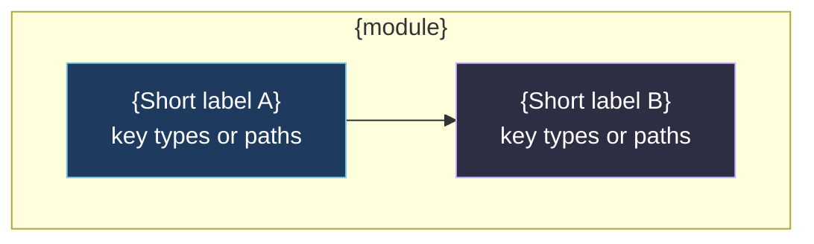
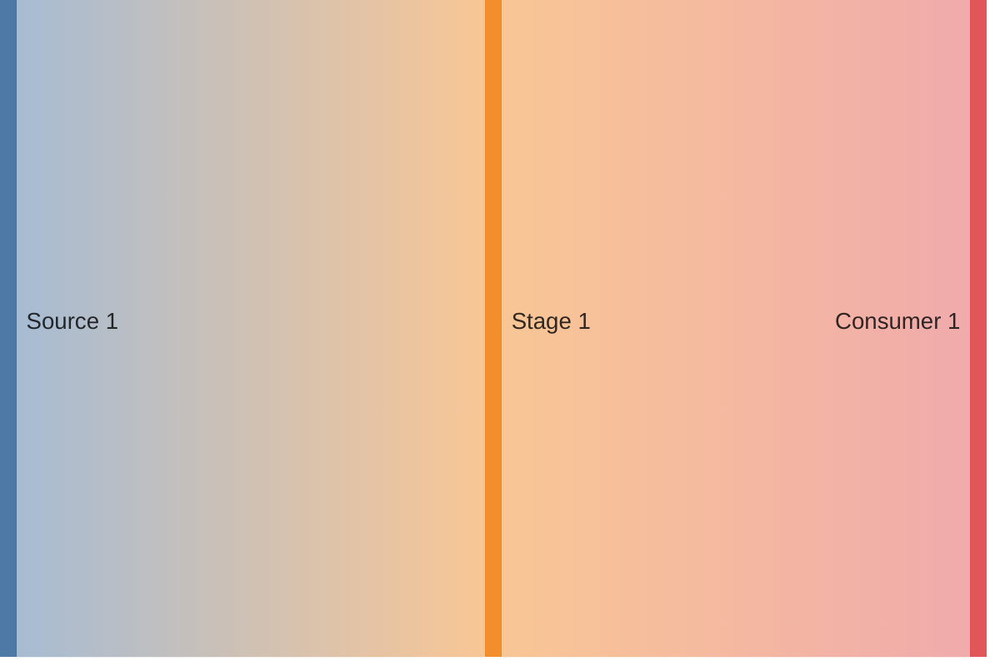

<!-- Module index (level-1 node): docs/{layer}/{module}/{module}.md.
     One level down: submodule_template.md for a child node, feature_design_template.md / specification_template.md for a leaf.
     No status fields or approval labels. Delete sections that have no content. -->

# {Layer title} — {Module}

One-line scope: what this **module** covers on this layer — design: user intent, UX, requirements; specification: implementation.

**Layer:** `{design | specification}`

**Cross-link:** [{other-layer}/{module}](../../{other-layer}/{module}/{module}.md) *(omit while the other layer has no page yet)*

---

## Children

| Child | Kind | Description | Doc |
|-------|------|-------------|-----|
| `{submodule}` | node | *(one-line purpose)* | [{submodule}/](./{submodule}/{submodule}.md) |
| `{feature}` | leaf | *(one-line purpose)* | [{feature}](./{feature}.md) |

---

## Shared Rules and Current State

Only content true for **two or more** children: shared mechanics, a minimal **Current State (as built)** reconstructed from code, shared questions and risks. Omit the section when there is none — the page is then a pure index.

---

## Module Visualization

Purpose: a one-glance map of children, runtime flow and main source folders (specification layer) or system relationships (design layer).

**Rules**

- Put **Mermaid only** in fenced blocks; do not put links inside node labels.
- Link children in normal Markdown under the diagram.
- Use this palette: `classDef hub fill:#1e3a5f,stroke:#7ec8e3` · `leaf fill:#2d2d44,stroke:#c9b1ff` · `ui fill:#3d2914,stroke:#ffb86c` · `data fill:#1a3320,stroke:#69ff94`.

### Subsystem Map (required)

Links: [{child-a}](./{child-a}/{child-a}.md), [{child-b}](./{child-b}.md).

### Optional — Data / UI Pipeline (`sankey-beta`)

---

## Code Map (optional, specification layer)

Aggregate table when this index should list the **main** entry points shared across children; otherwise defer to each child document.

| Type | Path | Role |
|------|------|------|
| `...` | `{path/from/project/root}` | ... |

---

## Dependencies

| Dependency | Direction | Notes |
|------------|-----------|-------|
| {other module / package / external service} | uses / used by | {brief} |

---

## Implementation Notes

Cross-links, gaps and "see also" for sibling modules. When adding a **new child**, use [submodule_template](../../_templates/submodule_template.md) for a node, or [feature_design_template](../../_templates/feature_design_template.md) / [specification_template](../../_templates/specification_template.md) for a leaf, and add a row to the Children table above.
