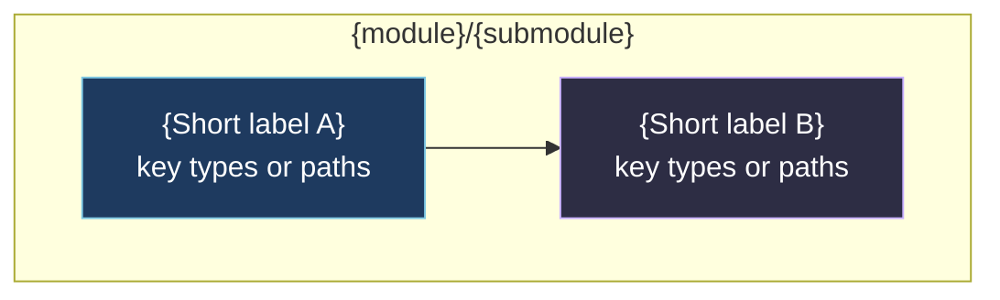
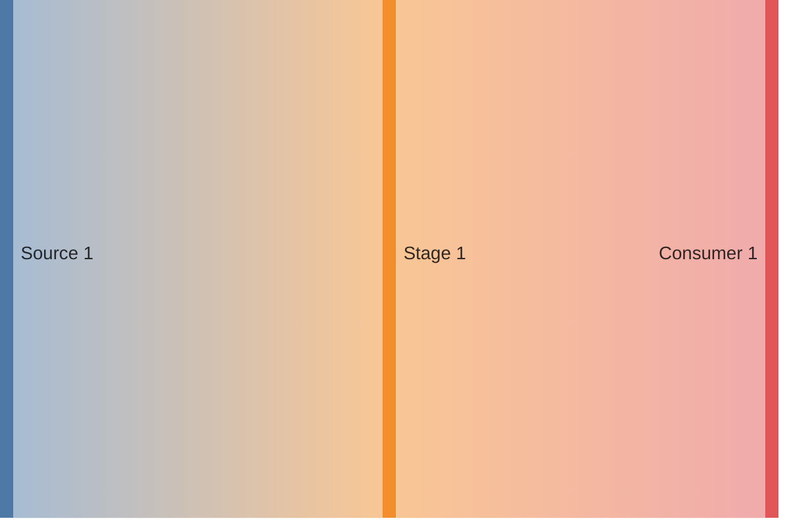

<!-- Nested node index (level 2 and deeper): docs/{layer}/{module}/{submodule}/{submodule}.md.
     One level up: module_template.md (Children table row).
     One level down: feature_design_template.md / specification_template.md for a leaf, this template again for a deeper node.
     No status fields or approval labels. Delete sections that have no content.
     Relative links below assume level 2; add one `../` per extra node level. -->

# {Layer title} — {Module} / {Submodule}

One-line scope: what this **submodule** covers on this layer — design: user intent for this slice; specification: implementation for this slice.

**Layer:** `{design | specification}`

**Module:** [{module}](../{module}.md)

**Cross-link:** [{other-layer}/{module}/{submodule}](../../../{other-layer}/{module}/{submodule}/{submodule}.md) *(omit while the other layer has no page yet)*

---

## Children

| Child | Kind | Description | Doc |
|-------|------|-------------|-----|
| `{feature}` | leaf | *(one-line purpose)* | [{Feature Name}](./{feature}.md) |
| `{child-node}` | node | *(one-line purpose)* | [{child-node}/](./{child-node}/{child-node}.md) |

---

## Shared Rules and Current State

Only content true for **two or more** children: shared mechanics, a minimal **Current State (as built)** reconstructed from code, shared questions and risks. Omit the section when there is none — the page is then a pure index.

---

## Submodule Visualization

Purpose: a one-glance map of features, runtime flow and main source folders (specification layer) or system relationships (design layer).

**Rules**

- Put **Mermaid only** in fenced blocks; do not put links inside node labels.
- Link features in normal Markdown under the diagram.
- Use this palette: `classDef hub fill:#1e3a5f,stroke:#7ec8e3` · `leaf fill:#2d2d44,stroke:#c9b1ff` · `ui fill:#3d2914,stroke:#ffb86c` · `data fill:#1a3320,stroke:#69ff94`.

### Subsystem Map (required)

Links: [{feature-a}](./{feature-a}.md), [{feature-b}](./{feature-b}.md).

### Optional — Data / UI Pipeline (`sankey-beta`)

---

## Code Map (optional, specification layer)

Aggregate table when this index should list the **main** entry points shared across features in this submodule; otherwise defer to each feature spec.

| Type | Path | Role |
|------|------|------|
| `...` | `{path/from/project/root}` | ... |

---

## Dependencies

| Dependency | Direction | Notes |
|------------|-----------|-------|
| {other module or submodule / package / external service} | uses / used by | {brief} |

---

## Implementation Notes

Cross-links, gaps and "see also" for sibling submodules and features. When adding a **new feature**, use [feature_design_template](../../../_templates/feature_design_template.md) / [specification_template](../../../_templates/specification_template.md) and add a row to the Children table above.
