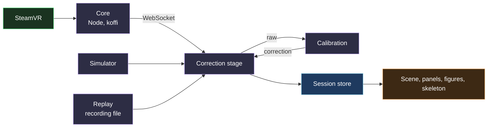

# Architecture

The components of the product, how data flows between them, and where the code
lives. Decisions and their reasons are in [decisions/](./decisions/).

## Components

| Component | Location | State | Role |
|---|---|---|---|
| Interface | `source/web/` | Works on live data, simulated data and recordings | Web application: the 3D scene, recording and replay, figures, skeleton; built from the design kit's web components |
| Core | `source/core/` | Reads devices, tracker roles and poses; run on a Quest 3 through Virtual Desktop | Background Node process that reads device poses from SteamVR and serves them over a local WebSocket ([live scene](../specification/scene/live-scene.md)) |
| Driver | — | Not started | Native SteamVR driver that applies the calibration and the alignment to device poses |

## Calibration and Alignment

The product computes two things: the initial calibration, from the motion of a
tracker joined to a controller, and the correction that keeps the spaces aligned
afterwards. Both end in one transform between the two tracking spaces,
`headsetFromLighthouse`. Only a driver can apply it to SteamVR.

Until the core and the driver exist, the interface computes the initial
calibration and applies the correction to the poses it shows, measures and
records, through `CorrectionStage` between the source and the session store
([ADR 0003](./decisions/0003-calibration-in-the-interface.md),
[calibration specification](../specification/calibration/calibration.md)). The
alignment during a session is not built.

## Data Flow

Every source of poses — the simulator, a replay of a recording, and the live
connection to the core — implements one interface, `PoseSource`. A source emits a
session description (devices, play areas, floor) and a stream of frames (one
sample per device). The correction stage applies the calibration to the
Lighthouse devices and passes raw frames to the calibration; the session store
receives the corrected stream and passes it on; nothing
after the store knows which source is active, except that the interface always
shows the kind of source, so that simulated or replayed data is never taken for
live data.

## Conventions

- Right-handed coordinates, +Y up, -Z forward, meters: the convention of OpenVR
  and of three.js.
- Rotations are unit quaternions `[x, y, z, w]`.
- A pose named `aFromB` maps a point given in space B into space A.
- Time is in seconds since the session started.

## Decisions

| ADR | Decision |
|---|---|
| [0001](./decisions/0001-web-interface-node-core.md) | Web interface, Node core, native driver |
| [0002](./decisions/0002-design-kit-web-components.md) | Design kit as web components in the interface |
| [0003](./decisions/0003-calibration-in-the-interface.md) | Calibration computed and applied in the interface |
