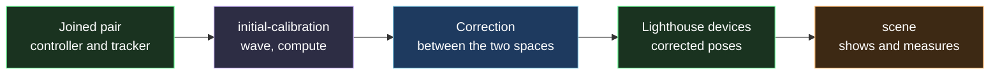

# Design — Calibration

Bringing the Lighthouse tracking space into the headset's tracking space: the
initial calibration, and keeping the two spaces aligned for the rest of the
session.

**Layer:** `design`

---

## Children

| Child | Kind | Description | Doc |
|-------|------|-------------|-----|
| `initial-calibration` | leaf | Aligning the two spaces by waving a tracker joined to a controller | [initial-calibration](./initial-calibration.md) |

Keeping the spaces aligned during a session has no page: its method is not
chosen. The candidates are in
[Space Alignment Research](../../research/space-alignment.md).

---

## Shared Rules and Current State

### Shared Rules

- **R1** — The product does the initial calibration and the alignment during a
  session itself. No other tool that changes device poses in SteamVR runs beside
  it: two such tools conflict.
- **R2** — The correction moves the devices tracked by Lighthouse. The headset
  and its controllers stay where the headset's tracking places them.
- **R3** — The initial calibration and the alignment during a session produce the
  same thing: one correction between the two tracking spaces. A later result
  replaces the earlier one.

### Current State (as built)

The initial calibration is built in the interface and runs on the simulator. The
correction applies only to what the interface shows, measures and records, not to
SteamVR: there is no driver yet
([ADR 0003](../../architecture/decisions/0003-calibration-in-the-interface.md)).
Nothing is kept between launches. Another pose-changing tool is not detected.
Alignment during a session is not built. Details are in the
[specification](../../specification/calibration/calibration.md).

### Open Items

| ID | Question | Why it matters | Proposed default | Answer |
|----|----------|----------------|------------------|--------|
| Q1 | Is keeping the spaces aligned during a session a second child of this module, or a module of its own? | Decides where its pages go once a method is chosen | A child of this module: it shares the correction, the stored calibration and the conflict with other tools | — |
| Q2 | Which devices does the correction move: every device tracked by Lighthouse, or only chosen ones? | Trackers that took no part in the calibration must end up in the right place too | Every device tracked by Lighthouse, as Space Calibrator does (Verified in its source) | — |
| Q3 | What does the product do when another pose-changing tool, such as Space Calibrator, is running? | Both would correct the same poses | Tell the user to turn the other tool off and do not calibrate until it is off; how the other tool is detected is not known | — |
| Q4 | Is a calibration kept across SteamVR restarts, and when is a kept calibration no longer trusted? | Decides whether the user calibrates at the start of every session | — | — |
| Q5 | What offset between the physical and the virtual position of a tracker is acceptable? | No acceptance criterion about accuracy can be written without it | — | — |
| Q6 | Does the correction include scale? | Space Calibrator stores a scale with each calibration (Verified in its source) | No scale | — |

---

## Module Visualization

Links: [initial-calibration](./initial-calibration.md).

---

## Dependencies

| Dependency | Direction | Notes |
|------------|-----------|-------|
| [scene](../scene/scene.md) | used by | The scene shows the devices and measures how well the spaces agree; it changes nothing itself |

---

## Related Documents

- [Product Design Document](../design.md)
- [Specification](../../specification/calibration/calibration.md) — the correction, the correction stage and what is built
- [Space Alignment Research](../../research/space-alignment.md) — candidate methods for the alignment during a session
- [Space Calibrator Internals](../../research/space-calibrator-internals.md) — how the existing tool calibrates and applies the result
