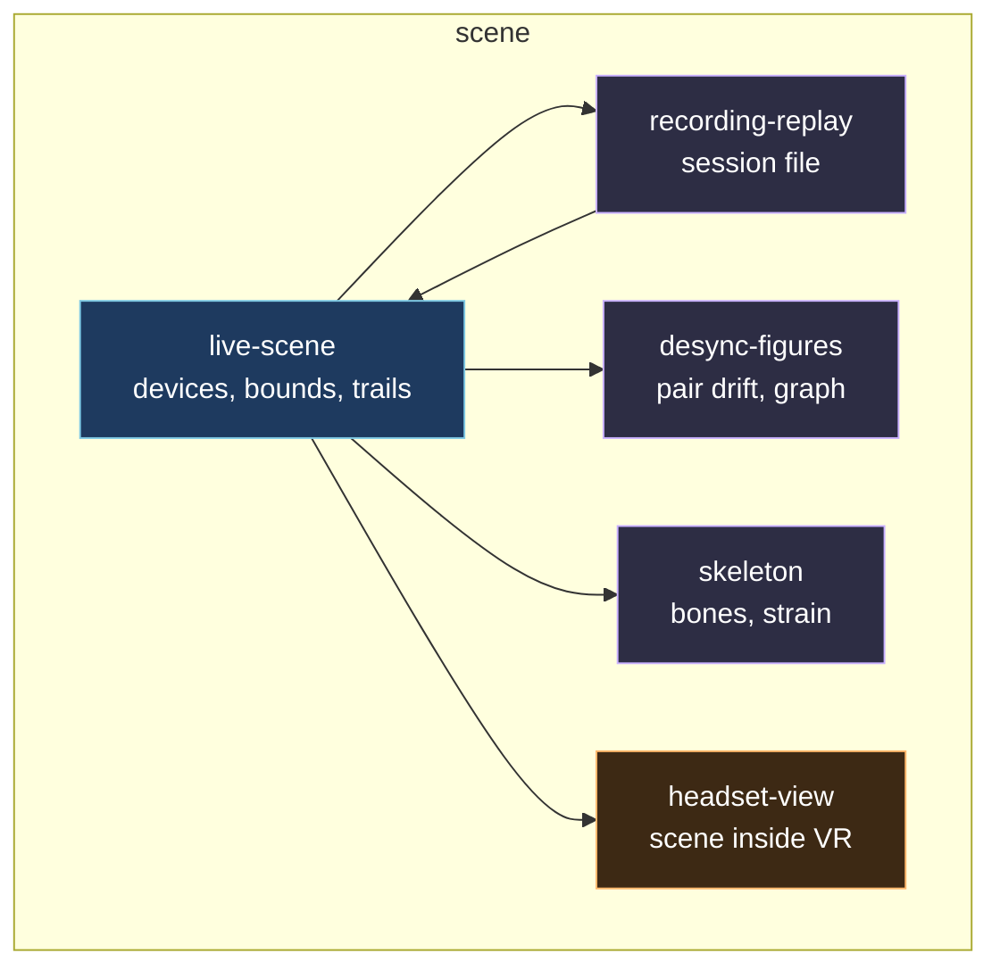

# Design — Scene

A 3D view of every tracked device in both tracking spaces, live and from
recordings, with figures that show how far the spaces have drifted apart.

**Layer:** `design`

---

## Children

| Child | Kind | Description | Doc |
|-------|------|-------------|-----|
| `live-scene` | leaf | The live 3D view in a desktop window | [live-scene](./live-scene.md) |
| `recording-replay` | leaf | Recording a session to a file and replaying it | [recording-replay](./recording-replay.md) |
| `desync-figures` | leaf | Distance and angle drift of a rigidly attached device pair, with a graph | [desync-figures](./desync-figures.md) |
| `skeleton` | leaf | A body skeleton driven by headset, controllers and trackers, with a strain figure that reveals drift | [skeleton](./skeleton.md) |
| `headset-view` | leaf | The same scene inside the headset | [headset-view](./headset-view.md) |

---

## Shared Rules and Current State

### Shared Rules

- **R1** — The scene is read-only. It shows poses and figures and changes nothing
  in the alignment of the tracking spaces. Calibration and its controls belong to
  the [calibration](../calibration/calibration.md) module.
- **R2** — Each device is drawn at its pose and is identifiable by role (headset,
  controller, tracker, base station) and by name or serial number. Two devices of
  the same role can be told apart.
- **R3** — Each device is marked with the tracking system that tracks it: the
  headset's tracking (headset, controllers) or Lighthouse (trackers, base
  stations). The marking does not rely on color alone.
- **R4** — A device that loses tracking stays at its last known pose and is marked
  "tracking lost". A device that disconnects is marked "disconnected". The two
  marks look different. A device that returns resumes without restarting the
  scene.
- **R5** — Live view and replay draw the same content the same way: devices,
  marks, trails and figures.

### Current State (as built)

The live scene, recording and replay, the desynchronization figures and the
skeleton are built and run on a simulated data source and on recordings. The
interface follows the designer's Stage layout. When the product's own correction
is applied, the scene shows the poses after it. The connection to SteamVR is not
built, so nothing has been run with real devices.
The headset view is not built. Details are in the
[specification](../../specification/scene/scene.md).

### Open Items

| ID | Question | Why it matters | Proposed default | Answer |
|----|----------|----------------|------------------|--------|
| Q1 | Does the VR runtime expose each device's pose before another tool's calibration is applied, or only after it? | If only after, the scene shows one already-corrected space, R3 marks the origin of a device only, and the desynchronization figures include the other tool's correction | Mark by tracking system; settle by a check on hardware | Only after it, for an application: a tool such as Space Calibrator rewrites the pose inside the runtime before any application receives it (read in its source; not confirmed by a run). When this product does its own calibration and no other tool runs, the runtime's poses are uncorrected |
| Q2 | Which play-area bounds are shown: the SteamVR chaperone, the headset's guardian, or both? | Showing both may expose a mismatch between the spaces | Both, marked by tracking system | — |
| Q3 | Once the product applies its own alignment, does the scene show poses before the correction, after it, or both? | Decides whether the user can see the correction working | Both | — |
| Q4 | Which colors and marks distinguish the two tracking systems and the device states? | Needed to draw R3 and R4 | — | The designer's brand: the headset's system blue with solid marks, Lighthouse amber with outlined marks; the role by silhouette (headset, controller, tracker, base station); "tracking lost" a dashed mark tagged `LOST`, "disconnected" a ghost mark tagged `OFF` |

---

## Module Visualization

Links: [live-scene](./live-scene.md), [recording-replay](./recording-replay.md),
[desync-figures](./desync-figures.md), [skeleton](./skeleton.md),
[headset-view](./headset-view.md).

---

## Related Documents

- [Product Design Document](../design.md)
- [Specification](../../specification/scene/scene.md) — code map, contracts and what is built
- [Calibration](../calibration/calibration.md) — the module that changes the alignment the scene shows
- [Space Alignment Research](../../research/space-alignment.md)
