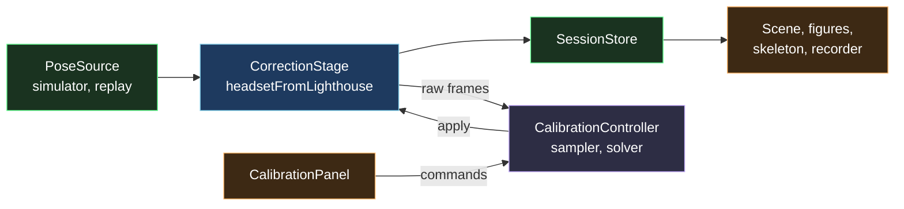

# Specification — Calibration

How the correction between the two tracking spaces is computed and applied in
the interface `source/web/src/calibration/`.

**Layer:** `specification`

**Cross-link:** [design/calibration](../../design/calibration/calibration.md)

---

## Children

| Child | Kind | Description | Doc |
|-------|------|-------------|-----|
| `initial-calibration` | leaf | Solver, sampling, controller and panel of the calibration by a joined controller and tracker | [initial-calibration](./initial-calibration.md) |

---

## Shared Rules and Current State

### The Correction

The correction is one pose `headsetFromLighthouse`: it maps a point given in
the Lighthouse tracking space into the headset's tracking space (design
[calibration](../../design/calibration/calibration.md) R3). It holds a rotation
about the vertical axis and a translation in meters; both runtimes are taken to
be aligned with gravity (Open Items Q1). A later result replaces the earlier one.

Where it is computed and applied until the core and the driver exist is decided
in [ADR 0003](../../architecture/decisions/0003-calibration-in-the-interface.md):
the interface computes it and applies it to the poses it shows, measures and
records. SteamVR and the view in the headset do not change.

### `CorrectionStage` — `calibration/correctionStage.ts`

A decorator of a `PoseSource`. Every source reaches `SessionStore` through it
(`attachSource` in `app/services.ts`), so the scene, figures, skeleton and
recorder see corrected poses, while the calibration samples the raw poses.

| Member | Contract |
|--------|----------|
| `wrap(source)` | Returns the source the store attaches. A new source clears the correction: its tracking spaces are new. A replay passes through uncorrected: a recording already holds what the user saw |
| `apply(headsetFromLighthouse)` | Sets the correction; returns `false` for a replay. Re-announces the session at once; the next frame is corrected |
| `clear()` | Removes the correction and re-announces the session |
| `getSnapshot`, `subscribe` | `{ headsetFromLighthouse: Pose \| null }` for React |
| `subscribeRaw(listener)` | Raw frames with their raw session, in time order |
| `subscribeOrigin(listener)` | `OriginChange` events of the wrapped source |

Correcting a frame (`calibration/applyCorrection.ts`, pure): every device of
the Lighthouse system with a pose, base stations and devices that are not
tracking included, gets `headsetFromLighthouse ∘ pose`; a null pose stays null;
headset devices are unchanged. Correcting a session moves the corners of the
Lighthouse play area; `floorHeight` is unchanged (Q2). Without a correction the
stage passes the source's own objects; with one it caches the corrected session
per raw session, because the scene, the recorder and the skeleton react to a new
session object.

A change of the correction (applied, replaced or removed) clears the reference of
the desynchronization figures and the skeleton fit: both are measured in the
corrected space, and keeping them would show the change of the correction as
drift or strain.

### `OriginChange` — `sources/source.ts`

`PoseSourceListener.onOriginChange?(change)` with `{ time, trackingSystem }`:
the origin of one tracking system moved (a headset recenter). Optional: a
source that cannot know it does not call it. The simulator calls it for the
headset system on a jump, and for both systems when the misalignment is reset.

### Current State (as built)

The correction, the stage and the initial calibration with its panel are built
and run on the simulator. Nothing is kept between launches. There is no
alignment during a session.

---

## Module Visualization

### Subsystem Map

Links: [initial-calibration](./initial-calibration.md).

---

## Dependencies

| Dependency | Direction | Notes |
|------------|-----------|-------|
| [scene](../scene/scene.md) | used by | Sources, `SessionStore`, the stage shell that hosts the panel |
| Driver | planned | Applies the same `headsetFromLighthouse` to SteamVR |

---

## Open Items

| ID | Question | Why it matters | Proposed default | Answer |
|----|----------|----------------|------------------|--------|
| Q1 | Are the Quest and the Lighthouse spaces both aligned with gravity? | The correction has no pitch or roll; a tilted Lighthouse floor of 0.5° gives about 17 mm at 2 m that is left in the fit error | Assume yes (Hypothesis in [space-alignment](../../research/space-alignment.md)); measure on hardware | — |
| Q2 | Which tracking system does `SessionInfo.floorHeight` belong to? | Decides whether the correction moves the floor | Leave the floor unchanged; settle with the live source | — |
| Q3 | Does an applied correction become stale after a headset recenter? | A recenter moves the headset's origin, so the correction no longer matches | Yes; handling it belongs to the alignment during a session | — |
